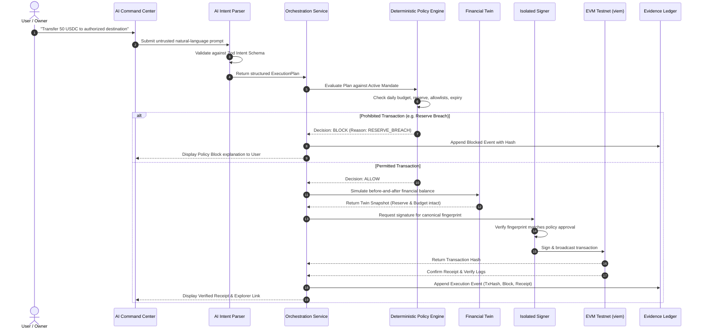

# ActaBound System Architecture Specification

## 1. Executive Overview

**ActaBound** is a mandate-governed autonomous on-chain wallet system designed for the **Shenzhen FinTechathon 2026 (International Track, Topic F: Agent Wallet)**. Under the theme *"AI as a Financial Participant"*, ActaBound demonstrates that artificial intelligence can autonomously execute on-chain financial operations safely only when it is bounded by **deterministic policy controls**, **isolated signing authority**, and **cryptographically verifiable evidence trails**.

The AI model functions exclusively as a planner and intent interpreter. It possesses zero access to cryptographic keys, cannot modify policy rules, and cannot authorize transactions.

---

## 2. Logical Components Breakdown

The system implements 17 distinct components with strict boundaries:

### A. Browser Frontend
- Built with **Next.js (App Router)**, **React 19**, **Tailwind CSS**, and accessible primitives.
- Features high-density fintech layouts inspired by institutional trading and treasury interfaces.
- Responsive across desktop, tablet, and mobile with light/dark/system themes.

### B. Authentication and Session Layer
- Manages secure sessions via `HttpOnly`, `SameSite=Lax`, and `Secure` cookies.
- Defends against CSRF and enforces per-endpoint rate limits.
- Validates user identity and active permissions before routing requests.

### C. AI Intent Parser
- Accepts natural-language user objectives (e.g. *"Rebalance portfolio while preserving 200 USDC reserve"*).
- Converts requests into typed, schema-validated intent structures using **Zod**.
- Sanitizes inputs against direct and indirect prompt injection attempts.

### D. Financial Planning and Orchestration Service
- Translates parsed intents into multi-step financial plans (e.g., target balance calculation, gas estimation).
- Orchestrates plan evaluation across policy, simulation, and execution subsystems.

### E. Mandate Management Service
- Authorizes and version-controls user-defined financial mandates (spending caps, reserve minimums, allowlists, expiries).
- Manages permission tiers:
  - **Tier 0 (Observer):** Read-only portfolio queries.
  - **Tier 1 (Planner):** Structured plan creation and simulation without broadcast rights.
  - **Tier 2 (Bounded Executor):** Autonomous execution strictly bounded by active mandate rules.
  - **Tier 3 (Owner Approval):** Required for mandate updates, unlisted destinations, or limit adjustments.

### F. Deterministic Policy Engine
- Standalone, pure TypeScript engine with zero LLM dependency.
- Performs exact, non-floating-point calculations using `bigint` and precision decimal math.
- Evaluates 17+ boundary rules (budget limits, reserve violations, allowlists, replay tokens, slippage thresholds).
- Returns typed decisions: `ALLOW`, `BLOCK`, or `REQUIRE_OWNER_APPROVAL`.

### G. Market and Risk-Data Adapters
- Provides normalized token prices, volatility metrics, and liquidity data.
- Enforces staleness timeouts and flags fallback demo data with visible indicators.

### H. Financial Twin Simulation Service
- High-fidelity pre-execution simulation modeling the balance sheet *before* and *after* execution.
- Computes reserve margin, remaining daily budget, estimated gas, and protocol exposure.

### I. Transaction Construction and Simulation Service
- Reconstructs canonical transaction calldata and performs on-chain or local simulation (`eth_call` / viem simulation).
- Generates deterministic transaction fingerprints using SHA-256 and Keccak-256.

### J. Wallet and Signing Adapter
- Cryptographically isolated signing service.
- Communicates with key stores protected by **AES-256-GCM** (or cloud KMS interfaces).
- LLM prompts and model contexts never receive raw private keys or seed phrases.

### K. Blockchain Execution Adapter
- Connects to EVM testnets (Sepolia / Amoy) via typed `viem` clients.
- Broadcasts transactions, polls receipts, handles gas spikes, and processes potential reverts.

### L. Receipt and Post-Execution Verification Service
- Validates on-chain transaction receipts against expected execution hashes.
- Inspects emitted contract events and verifies final balance changes against the pre-execution plan.

### M. Risk-Triggered Autonomy Controller
- Continuous monitoring sentinel.
- Transitions wallet state between `NORMAL`, `CAUTION`, `BLOCKED`, and `PAUSED`.
- Enforces fail-closed circuit breakers upon detecting stale data, abnormal velocity, or repeated reverts.

### N. Evidence Ledger
- Append-only, hash-linked cryptographic audit trail.
- Every state transition, intent, policy decision, transaction hash, and receipt is sealed into an immutable block hash chain.
- Includes an independent integrity verification tool to detect tampering.

### O. Autonomous Attack Arena
- Interactive red-team lab containing 18 adversarial scenarios (e.g. Budget Breaker, Reserve Breach, Prompt Injection, Recipient Substitution).
- Proves that security controls are actively enforced by the backend engine rather than simulated in the UI.

### P. PostgreSQL Persistence
- Relational storage managed through **Prisma ORM** with versioned migrations.
- Implements atomic transactions and row-level locks to prevent budget race conditions.

### Q. Security and Audit Services
- Centralized security posture dashboard.
- Displays active permission tiers, static analysis reports, attack results, and cryptographic key hygiene.

---

## 3. End-to-End Transaction Flow

---

## 4. Trust Boundaries & Security Enclaves

1. **Untrusted Boundary:** Browser client, user chat inputs, external RPC feeds, third-party contract metadata.
2. **Application Boundary:** Next.js Route Handlers, schema validation, session management.
3. **Core Enforce Boundary:** Deterministic Policy Engine, Atomic Budget Counters, Evidence Ledger.
4. **Secret Enclave:** Isolated Signing Adapter holding private credentials via AES-256-GCM. The LLM resides strictly outside this enclave.
