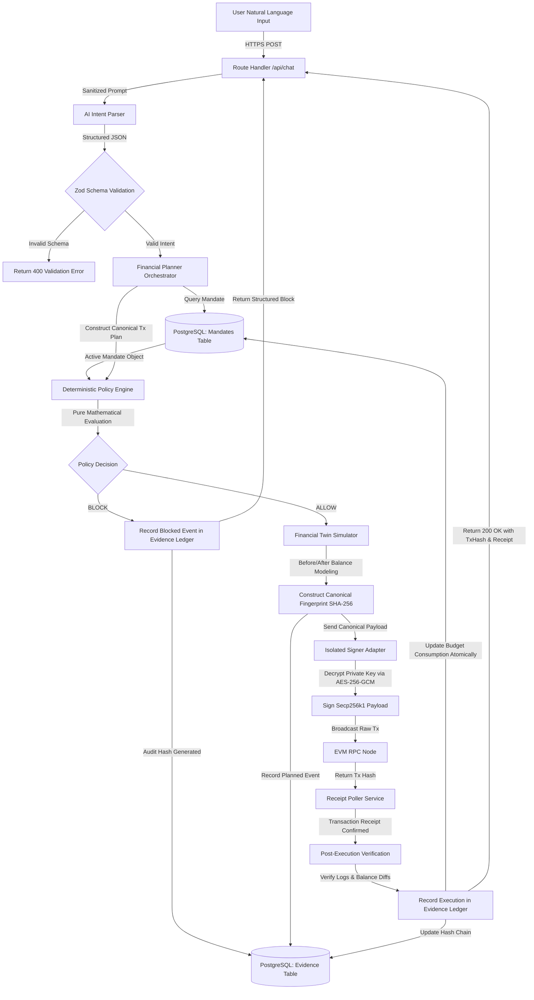

# ActaBound Data Flow Specification

## 1. Primary Data Lifecycles

This document specifies the exact flow of data, state transformations, and persistence mechanisms across ActaBound's subsystems.

---

## 2. Intent-to-Execution Data Pipeline



---

## 3. Data Structures & Schemas

### 3.1 Parsed Intent Schema (`IntentPayload`)
```typescript
{
  intentType: 'transfer' | 'swap' | 'rebalance' | 'query' | 'emergency_stop';
  chainId: number;
  recipient?: `0x${string}`;
  assetIn?: `0x${string}`;
  assetOut?: `0x${string}`;
  amountInUnits?: string; // Decimal string (e.g. "50.00")
  maxSlippageBps?: number;
  explanation: string;
}
```

### 3.2 Canonical Transaction Fingerprint
To guarantee that the exact transaction evaluated by the policy engine is identical to the payload signed by the wallet, a deterministic digest is computed:

$$\text{Fingerprint} = \text{SHA-256}\left(\text{CanonicalSerialize}\left(\text{chainId}, \text{mandateId}, \text{target}, \text{amount}, \text{calldata}, \text{nonce}\right)\right)$$

### 3.3 Evidence Ledger Event Structure
Each audit event contains:
- `id`: UUIDv4
- `sequenceNumber`: Auto-incrementing 64-bit integer
- `timestamp`: ISO-8601 UTC timestamp
- `eventType`: `INTENT_RECEIVED` | `POLICY_EVALUATION` | `TRANSACTION_BROADCAST` | `RECEIPT_CONFIRMED` | `RISK_HALT` | `ATTACK_SCENARIO_RUN`
- `correlationId`: Traces a single user intent through execution
- `payloadHash`: SHA-256 of the canonical event payload
- `previousBlockHash`: Digest of the preceding record (cryptographic link)
- `currentBlockHash`: $\text{SHA-256}(\text{previousBlockHash} \parallel \text{payloadHash} \parallel \text{sequenceNumber})$
