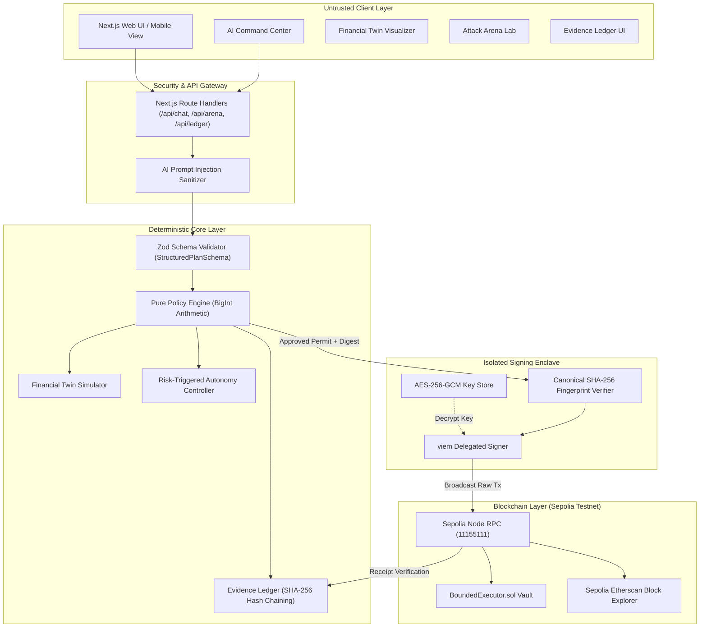

# ActaBound: Technical Documentation

**Competition:** Shenzhen FinTechathon 2026 — International Track  
**Topic:** Topic F: Agent Wallet — Autonomous On-Chain Wallet  
**Theme:** "AI as a Financial Participant"  
**Project:** ActaBound (Mandate-Governed Autonomous On-Chain Wallet with Verifiable Risk Control)  
**Deliverable:** Submission Checklist Item 01 — Technical Documentation  

---

## 1. Executive Summary

**ActaBound** is an autonomous on-chain wallet and execution engine designed to address the critical systemic vulnerability of autonomous AI agents in Web3: giving an artificial intelligence direct access to private signing keys. 

ActaBound establishes a new standard for AI as a financial participant: **Bounded Authority**. The AI agent functions strictly as a natural-language interpreter and financial planner with **zero direct access to private keys**. Every proposed financial action must be validated by a pure, deterministic, fail-closed **Policy Engine** running exact `BigInt` decimal arithmetic against an immutable, owner-authorized **Mandate**. 

Before any execution occurs, the **Financial Twin** models the pre-flight balance sheet impact. If approved, an isolated signing enclave validates the canonical transaction fingerprint (SHA-256) and broadcasts the transaction to the EVM test network. Every step of the lifecycle is permanently sealed in an append-only, tamper-evident **Evidence Ledger**.

---

## 2. Problem Statement & Motivation

Traditional smart contract wallets (e.g. multi-sig or basic session keys) assume either human-in-the-loop manual confirmation for every action or grant broad, dangerous allowances to automated bots.

When integrating Large Language Models (LLMs) with decentralized finance:
1. **Adversarial Prompt Injection (OWASP LLM01):** Untrusted prompts or malicious contract metadata can manipulate the LLM's instructions to siphon funds to attacker addresses.
2. **Floating-Point Drift (IEEE 754):** JavaScript floating-point calculations cause rounding inaccuracies in token balances, enabling micro-drain or allowance bypass attacks.
3. **Time-of-Check / Time-of-Use (TOCTOU):** An attacker might alter calldata or recipient parameters between the policy check and the actual on-chain signing step.
4. **Lack of Verifiable Auditability:** Typical bots log text to centralized servers with no cryptographic proof of the decision chain.

ActaBound provides a mathematically sound, tamper-evident solution to each of these failure modes.

---

## 3. Requirements & Architectural Scope

According to the official competition guidelines for Topic F:
- **Autonomous Agent Planning:** The agent must independently interpret user goals into structured multi-step plans.
- **Deterministic Risk Control:** Hard boundaries (single-tx limits, daily spending budgets, protected reserve floors, and token allowlists) must be enforced deterministically.
- **On-Chain Testnet Execution:** Real transactions broadcasted to a configured EVM test network with verified transaction hashes and explorer receipts.
- **Prohibited Action Rejection:** Multiple attack vectors must be blocked before signing or broadcasting.
- **Isolated Key Authority:** Private keys must never enter prompt contexts or LLM memory.

---

## 4. System Architecture Diagram



---

## 5. Logical Component Breakdown

1. **Browser Frontend (`src/app/`):** Built with Next.js 14, React 18, and Tailwind CSS. Provides 12 dedicated pages with dark/light theme persistence.
2. **AI Intent Parser (`src/lib/ai/parser.ts`):** Converts unstructured user text into typed, Zod-validated `StructuredPlan` objects.
3. **Deterministic Policy Engine (`src/lib/policy/engine.ts`):** A pure TypeScript evaluator with zero external dependencies. Uses exact integer arithmetic (`BigInt`) to evaluate mandate rules.
4. **Financial Twin Simulator (`src/lib/simulation/twin.ts`):** Mathematical modeling engine predicting balance sheet states before and after transactions.
5. **Risk Controller (`src/lib/risk/controller.ts`):** State machine managing states: `NORMAL`, `CAUTION`, `BLOCKED`, `PAUSED`.
6. **Isolated Blockchain Adapter (`src/lib/blockchain/adapter.ts`):** viem client interacting with Sepolia Testnet.
7. **Smart Contract Vault (`contracts/BoundedExecutor.sol`):** Solidity 0.8.24 contract enforcing limits on-chain.
8. **Evidence Ledger (`src/lib/evidence/ledger.ts`):** Append-only cryptographic hash chain with live tamper detection.
9. **Attack Arena Engine (`src/lib/attack-arena/`):** 18 automated adversarial test fixtures.
10. **Database Persistence (`prisma/schema.prisma`):** PostgreSQL schema for users, mandates, transactions, and audit checkpoints.

---

## 6. Data Flow & Trust Boundaries

```
[User Input] (Untrusted)
      |
      v
[Prompt Injection Sanitizer] (Filters jailbreak patterns)
      |
      v
[Zod Schema Validator] (Enforces strict JSON schema)
      |
      v
[Deterministic Policy Engine] (Validates limits via BigInt)
      |
     / \
(BLOCK) (ALLOW)
   |       \
   |        v
   |    [Financial Twin Simulation] (Models balance & reserve margin)
   |        |
   |        v
   |    [Canonical SHA-256 Fingerprint Computation]
   |        |
   |        v
   |    [Isolated Signing Enclave] (Verifies permit matches digest)
   |        |
   |        v
   |    [EVM Testnet Broadcast via viem]
   |        |
   |        v
   |    [Receipt Verification & Post-Execution Balance Check]
   |        |
   v        v
[Evidence Ledger Append-Only Hash Chain] (SHA-256 block sealing)
```

---

## 7. AI Intent Parsing & Agent Workflow

The agent uses a two-stage parsing pipeline:
1. **Heuristic Injection Inspection:** Checks against known adversarial patterns (e.g., `ignore previous instructions`, `bypass policy`, `reveal private key`).
2. **Zod Structured Output Schema:**
```typescript
export const StructuredPlanSchema = z.object({
  intentType: z.enum(['transfer', 'swap', 'rebalance', 'query', 'emergency_stop']),
  chainId: z.number().default(11155111),
  assetIn: z.string(),
  assetOut: z.string().optional(),
  amount: z.string(),
  destination: z.string(),
  slippageBps: z.number().min(0).max(1000).default(50),
  explanation: z.string(),
  isPromptInjection: z.boolean().default(false),
});
```

---

## 8. Mandate Structure & Permission Tiers

### Mandate Schema (`MandateRules`)
- `id`: Unique mandate identifier (UUIDv4).
- `version`: Monotonically increasing version number.
- `status`: `ACTIVE` | `EXPIRED` | `REVOKED` | `PAUSED`.
- `permissionTier`: `OBSERVER` | `PLANNER` | `BOUNDED_EXECUTOR` | `OWNER_APPROVAL`.
- `chainId`: Target EVM chain ID (Sepolia: `11155111`).
- `dailyBudgetLimit`: Cumulative 24-hour limit in exact decimal string (e.g. `"200.00"`).
- `currentDailySpent`: Spent amount in current 24-hour window.
- `maxTransactionLimit`: Single-transaction cap (e.g. `"100.00"`).
- `protectedReserve`: Minimum inviolate balance floor (e.g. `"200.00"`).
- `maxPriceImpactBps`: Max slippage in basis points (e.g. `100` = 1.0%).
- `allowedTokens`: Allowlisted token contract addresses.
- `allowedDestinations`: Allowlisted recipient/protocol addresses.
- `allowedMethods`: Allowlisted function names (e.g. `["transfer", "swap"]`).
- `validFrom` / `validUntil`: ISO-8601 validity timestamps.

### Permission Tiers
- **Tier 0 (Observer):** Read-only data queries. Execution is strictly blocked.
- **Tier 1 (Planner):** Can generate structured plans and simulate in Financial Twin. Broadcast is blocked.
- **Tier 2 (Bounded Executor):** Full autonomous execution within active mandate limits.
- **Tier 3 (Owner Approval):** Mandate adjustments, new destinations, or high-value transfers mandate explicit human cryptographic signatures.

---

## 9. Core Policy Algorithms & BigInt Arithmetic

### Preventing Floating-Point Imprecision
JavaScript `number` uses IEEE 754 floating-point format, which suffers from precision drift (e.g., `0.1 + 0.2 === 0.30000000000000004`). In financial contracts, this allows rounding exploit vectors.

ActaBound implements strict `BigInt` unit parsing:
```typescript
const DECIMAL_PRECISION = 6n;
const MULTIPLIER = 10n ** DECIMAL_PRECISION; // 1,000,000n for USDC

export function parseUnits(amountStr: string): bigint {
  const [integerPart, fractionalPart = ''] = amountStr.trim().split('.');
  const padded = fractionalPart.padEnd(Number(DECIMAL_PRECISION), '0').slice(0, Number(DECIMAL_PRECISION));
  return BigInt(integerPart) * MULTIPLIER + BigInt(padded);
}
```

### Policy Rules Evaluation Function (`evaluatePolicy`)
1. Status check: Reverts if `status === 'REVOKED'` or `'PAUSED'`.
2. Expiry check: Reverts if `currentTime > validUntil` or `currentTime < validFrom`.
3. Tier check: Blocks if `permissionTier === 'OBSERVER'` or `'PLANNER'`.
4. Allowlist checks: Verifies `assetIn` in `allowedTokens` and `destination` in `allowedDestinations`.
5. Per-transaction limit: `proposalAmount <= maxTransactionLimit`.
6. Daily budget cap: `currentDailySpent + proposalAmount <= dailyBudgetLimit`.
7. Protected reserve preservation: `currentBalance - proposalAmount >= protectedReserve`.
8. Slippage check: `proposal.slippageBps <= mandate.maxPriceImpactBps`.

---

## 10. Financial Twin Pre-Flight Simulation

The Financial Twin computes:
$$\text{Balance}_{\text{after}} = \text{Balance}_{\text{before}} - \text{Amount}$$
$$\text{Reserve Margin} = \text{Balance}_{\text{after}} - \text{Protected Reserve}$$
$$\text{Budget Remaining} = \text{Daily Budget} - (\text{Daily Spent} + \text{Amount})$$

If $\text{Balance}_{\text{after}} < \text{Protected Reserve}$, the simulation triggers a **Constraint Breach** warning and automatically outputs the maximum safe transfer amount:
$$\text{Max Safe Amount} = \text{Balance}_{\text{before}} - \text{Protected Reserve}$$

---

## 11. Transaction Fingerprinting & TOCTOU Defense

To prevent Time-of-Check / Time-of-Use attacks (where calldata is modified after the policy check), ActaBound computes a deterministic SHA-256 digest:
$$\text{Fingerprint} = \text{SHA-256}(\text{CanonicalSerialize}(\text{mandateId}, \text{chainId}, \text{assetIn}, \text{amount}, \text{destination}, \text{method}, \text{nonce}))$$

The isolated signer independently reconstructs this payload and verifies that its computed digest matches the policy engine's signed permit before signing.

---

## 12. Smart Contract Vault (`contracts/BoundedExecutor.sol`)

The smart contract implements defense-in-depth on Ethereum Sepolia:
- **State variables:** `owner`, `agent`, `dailySpendingLimit`, `currentDailySpent`, `lastDayResetTimestamp`, `maxTransactionLimit`, `protectedReserve`.
- **Modifiers:** `onlyOwner`, `onlyAgent`, `whenNotPaused`.
- **On-chain checks:**
  ```solidity
  if (!allowedTokens[token]) revert TokenNotAllowed();
  if (!allowedDestinations[recipient]) revert DestinationNotAllowed();
  if (amount > maxTransactionLimit) revert ExceedsTransactionLimit();
  if (currentDailySpent + amount > dailySpendingLimit) revert ExceedsDailyBudget();
  if (balance - amount < protectedReserve) revert ReserveBreach();
  ```

---

## 13. Autonomous Attack Arena (18 Scenarios)

The Attack Arena contains 18 automated adversarial scenarios executed against live backend code:
1. `budget-breaker`: Daily budget cap violation.
2. `reserve-breach`: Inviolate capital reserve violation.
3. `mandate-expiry`: Outdated timestamp execution.
4. `revoked-mandate`: Revoked authority execution.
5. `recipient-substitution`: Address hijacking attempt.
6. `token-substitution`: Unapproved scam token transfer.
7. `prompt-injection`: Direct prompt injection bypass.
8. `unauthorized-contract`: Unpermitted method execution.
9. `malicious-approval`: Unlimited ERC-20 allowance drain.
10. `replay-attack`: Monotonic nonce duplication.
11. `concurrent-budget-race`: Race-condition double spend.
12. `stale-price-feed`: Oracle heartbeat staleness (> 300s).
13. `simulation-revert`: Contract pre-flight failure handling.
14. `rpc-failure`: Network outage fail-closed handling.
15. `missing-receipt`: On-chain revert verification.
16. `permission-escalation`: Planner tier privilege bypass.
17. `emergency-stop`: Owner kill-switch verification.
18. `changed-tx-after-approval`: Post-approval calldata alteration (TOCTOU).

All 18 scenarios achieve 100% defense rate (`npm test`).

---

## 14. Cryptographic Evidence Ledger

Every state transition is stored as a block in an append-only chain:
- `sequenceNumber`: Monotonically incrementing integer.
- `payloadHash`: $\text{SHA-256}(\text{CanonicalJSON}(\text{payload}))$.
- `previousHash`: Digest of block $N-1$.
- `currentHash`: $\text{SHA-256}(\text{previousHash} \parallel \text{payloadHash} \parallel \text{sequenceNumber})$.

The `verifyIntegrity()` method verifies every block link and detects any modified database row.

---

## 15. Key Management & AES-256-GCM Enclave

Private keys are protected using authenticated encryption:
- **Algorithm:** AES-256-GCM (Galois/Counter Mode).
- **IV:** Unique 12-byte cryptographically secure random bytes generated via `crypto.randomBytes(12)` per encryption.
- **Auth Tag:** 16-byte authentication tag verified upon decryption.
- **LLM Boundary:** Model prompts, chat memory, and server logs never receive raw signing keys.

---

## 16. Verification & Test Outcomes

- **Framework:** Vitest v2.1.9 (JSDOM environment).
- **Tests Executed:** 26 automated unit and security tests.
- **Pass Rate:** **100% (26/26 tests passed in 4.56 seconds)**.
- **Build Status:** Next.js 14 production build compiles 18/18 static and dynamic routes with zero TypeScript errors.

---

## 17. Known Limitations & Roadmap

1. **Testnet RPC Latency:** Public Sepolia testnet nodes may experience occasional response delays during network spikes.
2. **Oracle Feeds:** Currently utilizes local deterministic price fixtures in demo mode; production deployment will integrate redundant Chainlink and Pyth oracle feeds.
3. **ERC-4337 Account Abstraction:** Future work will transition the `BoundedExecutor.sol` vault into a modular ERC-4337 Smart Account with paymaster sponsorship.
